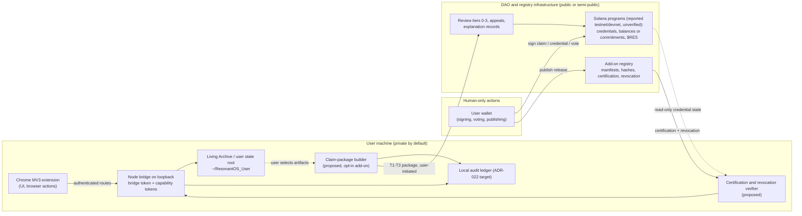

# OS-DAO interaction architecture (Stage 1, lead)

Status: v0.2, 2026-10-20. Sections 1-11 were drafted before the Stage 1 agent wave reported; section 12 reconciles them with os-map.md, capability-matrix.md, dao-requirements.md and timeline.md. Where sections 1-11 and section 12 differ, section 12 is current. Everything below that describes DAO-side behaviour is design (status D) or plan (E); no DAO code or deployment has been verified at the time of writing. OS-side statements rest on project ADRs (reported by authors) plus a light read of the clone at 578fbbc; code-level confirmation is delegated to the OS archaeologist.

## 1. Summary

ResonantOS and ResonantDAO must stay two systems with a thin, consent-driven interface. The OS is a local, sovereignty-first runtime (Chrome MV3 extension plus loopback Node bridge, per `docs/architecture/ALPHA_RUNTIME_BOUNDARY.md`). The DAO is a membership, contribution-accounting and governance layer whose on-chain footprint is undecided (whitepaper v0.6, 2026-08-30; contribution-economy "working specification"). The project's own documents already state the two invariants that matter most: "Neither an NFT nor a DAO vote becomes a runtime root credential" (`docs/planning/02-sdk-dao-governance-roadmap.md`) and wallet signing, payments, login and public submission are human-only (`ALPHA_RUNTIME_BOUNDARY.md`, "Extension Boundary"). This document turns those into an exchange inventory, consent tiers and a list of requirements that are genuinely shared versus ones that must stay separate. Confidence that this is the right shape: medium-high; confidence in any specific DAO-side mechanism: low until Stage 2/3.

## 2. Evidence base

| Item | Source | Status | Evidence type |
|---|---|---|---|
| Two-component Alpha runtime; privileged path extension -> loopback -> capability-gated route | `docs/architecture/ALPHA_RUNTIME_BOUNDARY.md` @578fbbc | A/B (code confirmation pending from s1-osmap) | reported by authors |
| Route owners incl. `/addons/*`, `/opencode/*`, `/memory/*`, `/archive/*`, `/diagnostics/report` | same, "Route Owners" table | pending | reported by authors |
| Human-only wallet/signing/value actions; read-only wallet detection only in Alpha | `ADR-008-wallet-web3-security.md` (Accepted 2026-04-23, Alpha applicability Partial) | D for signing flow; A/B for human-only boundary (pending) | reported by authors |
| Portable User State root with `Wallets/`, `Logs/audit-ledger.jsonl`; encrypted vault deferred | `ADR-022` (Accepted 2026-04-28, Partial) | D (vault), B (root) | reported by authors |
| Add-on registry model: manifests, hash-pinned/signed curated add-ons, sideload never trusted | `ADR-023` (Accepted 2026-04-28, Partial: external registry deferred) | D/E | reported by authors |
| Store/commerce model deferred, registry remains trust authority | `ADR-024` (Accepted, Deferred) | E | reported by authors |
| Guardian/Engineer, core-only capability class, "privilege follows authority", caller attribution | `ADR-038` (Accepted 2026-09-15, Partial: Guardian not implemented) and `docs/planning/02-sdk-dao-governance-roadmap.md` (proposal, 2026-09-14) | D | reported by authors |
| Certification object bound to release (id+version+hash, publisher, capability set, reviewer attestations + NFT role, policy version, expiry, revocation state) | `docs/planning/02-...` section 7 | D (proposal, not ADR) | reported by authors |
| Developer NFT levels L0-L4, "provisional, must be ratified by a governance ADR" | `docs/planning/02-...` section 8 | D | reported by authors |
| DAO credentials: 5 non-transferable wallet-bound NFTs; AI member needs human sponsor; one active member credential per wallet | whitepaper v0.6 via WebFetch summary (`stage1/sources/lead/whitepaper-webfetch-summary-2026-10-20.md`) | D ("contract work on testnet/devnet" is reported, unverified -> F) | reported by authors (tool summary) |
| 22 non-transferable balances, $RCT derived, $RES transferable; review tiers 0-3; explanation records; human/AI attribution split | contribution-economy via WebFetch summary | D | reported by authors (tool summary) |
| The contribution-economy page says nothing about ResonantOS data flows or privacy | same | fact about the source | inspected (summary) |

## 3. Principals on each side

OS-side principals (from ADR-038 and planning/02; code confirmation pending):
- Local human user: final local authority; grants capabilities; performs human-only actions.
- First-party components (Augmentor, chat, Living Archive services): "first-party does not imply privileged"; request authority through the privileged boundary.
- Add-ons and external harnesses (OpenCode, DSH/Hermes): bounded delegated authority; caller attribution retained through delegation; session-scoped source attribution exists for OpenCode (STATUS.md, #321).
- Bridge as enforcement point: bridge token plus scoped capability tokens, re-checked server-side.

DAO-side principals (whitepaper, contribution economy):
- Human Community Member (wallet-bound, non-transferable credential).
- AI Community Member (wallet-bound; requires active human sponsor; linked to a human).
- Sponsor (human accountable for an AI member).
- Reviewer / certifier / appeal panellist (role credentials; Developer NFT levels are an OS-side proposal, not yet in the DAO spec).
- Custodians during the bootstrap period.

Identity mapping rule: an OS principal is never automatically a DAO principal. Linking a local OS identity to a wallet-bound DAO credential is an explicit, revocable, user-performed act, and the OS must keep working with no link.

## 4. Exchange inventory

Legend: direction OS->DAO means data leaves the user's machine toward DAO infrastructure (registry, reviewers, chain). "Registry" is the add-on registry of ADR-023, which may be run by the DAO or by the project; it is the natural meeting point.

| # | Exchange | Direction | Initiator | Consent model | Minimum data (minimisation) | OS component (today / proposed) | DAO component (proposed) | Status | Shared or separate |
|---|---|---|---|---|---|---|---|---|---|
| E1 | Membership or role proof | DAO -> OS | User | User links wallet; OS reads public credential state only | Credential type, validity, revocation status; no balances | Read-only wallet detection (ADR-008 Alpha note) / credential verifier module | Credential registry or on-chain NFT state | D | Shared interface, separate implementations |
| E2 | Opt-in contribution evidence (claim package) | OS -> DAO | User, per claim | Explicit per-claim consent with preview of exactly what leaves | Hash commitments by default; redacted summaries or artifacts only when the user selects them | Living Archive export (#179, planned), research-trail save (#227, beta.2), delegation artifacts and receipts in `~/ResonantOS_User` / claim-package builder | Claim intake (Tier 0-3 review), explanation record | E (OS), D (DAO) | Separate: OS builds packages; DAO judges them |
| E3 | Artifact provenance and human/AI attribution | OS -> registry/DAO, embedded in E2 and E5 | User | Same as E2 | Signed provenance record: artifact hash, tool/harness identity, session-scoped source attribution, human vs AI portion as declared | OpenCode session attribution (#321, reported), manifest provenance (ADR-023) / provenance record signer | Attribution rules ("human and AI portions attributed separately; voting counts only the human portion") | B/C (OS attribution), D (DAO) | Shared schema |
| E4 | Add-on acceptance / certification | DAO -> registry -> OS | Reviewers; user at install | User installs; OS verifies certification; certification never grants runtime authority | Certification object bound to id+version+hash; revocation state | Bundled manifests and explicit grants (ADR-023 Alpha note) / certification verifier at install and update | Certification pipeline and revocation list (planning/02 sections 6-7) | D/E | Shared object schema; separate trust roots (OS verifies signatures, DAO decides policy) |
| E5 | Marketplace publication | Creator (via OS or directly) -> registry | Creator | Publisher identity; package hash; capability set; this is a public action, so human-only submit boundary applies | Package, manifest, hash, signature, source provenance | Add-ons workspace (functional, per ADR-024) / publisher tooling | Registry review state; store presentation separate from installation authority | E | Separate (registry owns), OS verifies |
| E6 | Capability grants | none across the boundary | User only | Local | none | Bridge capability tokens, grant presets, core-only class (ADR-038) | none; a DAO role may at most be a trust-tier hint displayed to the user | invariant | Must stay separate |
| E7 | Proof of work / outcome receipts | Forge, registry, DAO tooling -> DAO | System events | Tier 0 deterministic events (merged PR, certified release, completed review) need no OS private data | Event id, actor credential, hash | none needed in OS | Event verifiers | D | Separate; keep most Tier 0 evidence off the OS entirely |
| E8 | Wallet actions (claim a credential, sign a claim package, receive $RES) | User <-> chain | User | Human-only signing; OS may construct a transaction or display it, never sign automatically | Transaction payload summary and audit artifact | Human-only boundary (ALPHA_RUNTIME_BOUNDARY), signing flow design (ADR-008, D) | Solana programs (reported testnet/devnet, unverified) | D / F | Separate; OS provides UX and audit, custody stays with user wallet |
| E9 | Governance participation | User -> DAO | User | Human-only; the OS must not vote on the user's behalf, and AI members' work does not carry voting weight | Vote payload | none required | Contextual-weight voting | D | Separate |
| E10 | Revocation signals | DAO/registry -> OS | Registry | Automatic check at install/update/start; user informed | Revocation list entries | none today / revocation checker tied to Guardian baseline (ADR-038: rollback must not restore revoked authority) | Revocation state in certification object | D | Shared schema |

Explicitly NOT exchanged, ever, without a per-item user action: Living Archive contents (HUMAN_KNOWLEDGE, EXTERNAL_KNOWLEDGE, AI_MEMORY), prompts and chat transcripts, browser history and page content captured by the extension, provider credentials, diagnostics reports, delegation workspaces. The DAO has no query path into the OS; all E2/E3 data is pushed by the user.

## 5. Consent and disclosure tiers

| Tier | What leaves the machine | When | Reversibility |
|---|---|---|---|
| T0 none | nothing | default for every OS user | n/a |
| T1 commitments | hashes of selected artifacts, timestamps, declared dimensions, provenance record (tool identity, human/AI split) | user files a claim | user can withdraw a pending claim; settled balances are corrected through the DAO's reversible-correction rule, not by deleting history |
| T2 redacted summary | user-edited summary plus commitments | reviewer needs context (Tier 1-2 review) | as T1 |
| T3 artifact disclosure | selected files or excerpts | user chooses, typically for Tier 2 review or appeal | as T1; disclosed content cannot be unpublished from reviewers |

Rules: consent is per claim, previewed, logged locally in `Logs/audit-ledger.jsonl` (ADR-022 target) and never implied by installing the OS or linking a wallet. Reviewers' explanation records must reference commitments and the user's disclosed material only. Public-chain representation, if any, holds commitments and balances, never T2/T3 content (open item in the whitepaper: "on-chain representation of the 22 balances").

## 6. Invariants

- I1 ResonantOS is fully useful with no wallet, no credential and no network path to the DAO. Every DAO-facing module is an optional add-on or a disabled-by-default bridge service with its own capability.
- I2 No DAO state becomes runtime authority. Credentials, roles, certification and votes can inform display and policy defaults but never mint capability tokens or touch core-only invariants (ADR-038).
- I3 All OS->DAO data is user-initiated, previewed, minimised and locally logged. No background telemetry, no DAO-side query API into the OS.
- I4 Human-only actions (wallet signing, payments, public submission, voting) are enforced at the bridge, not in UI (consistent with #240 "non-bypassable public-submit handoff", reported).
- I5 Human/AI attribution is carried from the point of work (harness session attribution) into every provenance record and is never collapsed before the DAO applies its attribution rules.
- I6 Certification binds to an exact release hash, is checked at install, update and start, and revocation is honoured even across Guardian rollback.
- I7 Evidence packages are reproducible: a third party can recompute every commitment from the disclosed material (mirrors the DAO's "explanation record reproducible by a third party").
- I8 Separation of money from authority: $RES holdings, $RCT and dimension balances never alter OS behaviour, grants or trust tiers automatically.
- I9 Sponsor accountability for AI members does not give the sponsor access to the AI member's OS instance data; it is a DAO-side liability relation only.
- I10 Both systems keep independent audit trails; neither trail is the other's source of truth.

## 7. Shared versus separate requirements (preliminary; feeds gaps.md)

Shared (one schema, two implementations):
- S1 Provenance and attestation record format: hash commitments, signer identity, timestamps, human/AI split, tool identity. Candidates to search in Stage 2: in-toto/SLSA attestations, W3C Verifiable Credentials/Data Integrity, Sigstore bundles, EAS-style attestations (chain-neutral check needed for Solana).
- S2 Signed add-on manifest and certification object: id, version, hash, capability set, publisher, reviewer attestations, policy version, expiry, revocation. Candidates: Sigstore/cosign, TUF/The Update Framework, SLSA provenance, npm provenance, Chrome Web Store signing model, Obsidian/VS Code marketplace models.
- S3 Non-transferable, wallet-bound credential verification (read-only) on Solana: Token-2022 non-transferable extension, Metaplex, Solana Attestation Service, Civic Pass, soulbound patterns; plus revocation and recovery semantics.
- S4 Revocation distribution: list format, freshness, offline behaviour.

Separate (must not be merged):
- P1 Capability enforcement, policy, grant presets: OS only.
- P2 Contribution scoring, calibration, review tiers, appeals: DAO only; the OS supplies evidence packages and nothing else.
- P3 Token economics, treasury, emissions: DAO only; irrelevant to OS runtime.
- P4 Memory, Living Archive, browser control: OS only.
- P5 Governance and voting: DAO only, human-only.

## 8. Data-flow and trust-boundary diagram (draft; proposed components dashed in the article version)

Trust boundaries: (1) extension/bridge loopback with tokens; (2) bridge/user-state root; (3) machine/DAO network, crossed only by user-initiated E2/E3/E5/E8/E9 and by inbound signed certification data E4/E10; (4) wallet custody, human-only.

## 9. Friction these protections cause (to be weighed, not hidden)

- Per-claim consent and preview adds a ceremony to every contribution claim; frequent small claims will feel heavy. Mitigation: batch claims per cycle, default to T1 commitments.
- Keeping Tier 0 evidence off the OS means contributors must link forge and registry identities to their DAO credential; this is another identity-linking step.
- Human-only publish and sign steps block fully automated release pipelines for add-on creators.
- Hash-commitment-only evidence shifts review burden to reviewers who must request T2/T3 disclosure; appeals get slower.
- Certification checks at start and update need network access or a cached revocation list; offline users see stale trust states.
- Non-transferable credentials with recovery semantics are hard: lost keys mean re-issuance ceremonies and reputation portability questions the spec has not answered.

## 10. Open questions and dependencies

- Q1 Does the Alpha already produce any machine-readable receipts (delegation artifacts, research trail) that a claim-package builder could reuse? (s1-osmap)
- Q2 Is there any DAO-side artifact at all (program, IDL, mint, repo) beyond the whitepaper? (s1-census, s1-dao)
- Q3 Does the DAO spec say anything about data flows from ResonantOS? The contribution-economy page does not; whitepaper check pending (s1-dao).
- Q4 Which document governs the Developer NFT levels: an OS planning doc proposes them, the whitepaper lists different credential types. Conflict to resolve (s1-timeline, s1-dao).
- Q5 How does "AI member requires human sponsor" map to OS harness identities (OpenCode, DSH) that are not members at all? Likely answer: harness sessions are tools of the human member, not AI members; AI membership is a separate DAO-level actor. Needs the maintainers' decision.
- Q6 Is any on-chain representation of balances intended at all (whitepaper open item)? Determines whether S3 needs balance-bearing tokens or only credential NFTs.

## 11. Candidate requirement IDs (now mapped into gaps.md)

R-cand-1 -> R12 (provenance records and claim packages). R-cand-2 -> R18 (signed manifests, certification, revocation). R-cand-3 -> R22 (non-transferable credentials on Solana). R-cand-4 -> R12 and R23. R-cand-5 -> R11 (tamper-evident audit and approval ledger). R-cand-6 -> R12 and R07 (caller attribution through delegation).

## 12. Reconciliation after the Stage 1 wave (v0.2, 2026-10-20)

What the four agent reports change in this document:

- Q1 answered in part: the Alpha has a harness subsystem with "host-signed receipts" merged 2026-09-21 to 2026-10-18 (timeline, PRs #469-#490, #534) and a research-trail intake (OSC-12), but the Living Archive provenance directory is created empty (OSC-26) and the harness governs nothing in a stock install (OSC-30). So a claim-package builder has a receipt format to start from, not a working provenance pipeline. Code-level confirmation of the receipt format is a Stage 3 task.
- Q2 answered: no official DAO program, IDL or mint exists publicly (census D01-D03). Legacy devnet artifacts from a superseded token model do exist (dao-requirements section 1 item 3 and 8): a non-transferable Token-2022 $RCT mint, an SPL $RES mint with supply above the stated plan and a live mint authority, and an upgradeable program controlled by one key. These are evidence of past experiments, not of the v0.6 design. E8 and E1 therefore remain D/F, and the diagram's chain node should read "no official program; legacy devnet artifacts only".
- Q3 answered: the DAO spec says "The software logs every member action together with its candidate class combination" (DR-19, I-14), which conflicts directly with invariant I3 (user-initiated, per-item evidence). This document keeps I3 as the project's stated OS principle and flags the DAO text as a contradiction for the maintainers (gate report, decision needed).
- Q4 confirmed as a conflict: three ladders exist (member Levels in the whitepaper, Builder tiers on the join pages, Developer NFT levels L0-L4 in the OS planning doc) with no stated boundary (DR-40, I-11). E1 must therefore verify a credential type and version, not a "level".
- Q5 unchanged; still a maintainer decision.
- Q6 unchanged; whitepaper open item, now sharpened by the finding that the legacy devnet minted $RCT independently of any 22-vector (DR-36).
- New: human-only enforcement in the Alpha is extension-side DOM heuristics with no host-side checkpoint (OSC-19/20/47). Invariant I4 ("enforced at the bridge") is therefore a target, not a description of current code. The approval ledger in R11 is the mechanism that would make I4 true.
- New: the Alpha's credential handling contradicts E6/I2 assumptions in one place: provider keys are injected into delegated children (OSC-16, OSC-33). Not a DAO issue, but it shows that "the bridge owns credentials" is not yet enforced end to end (R03).
- Status change: E3 "OS attribution" downgraded from B/C to C: OpenCode session-scoped attribution exists (OSC-35) but nothing carries human/AI portions into any record.
